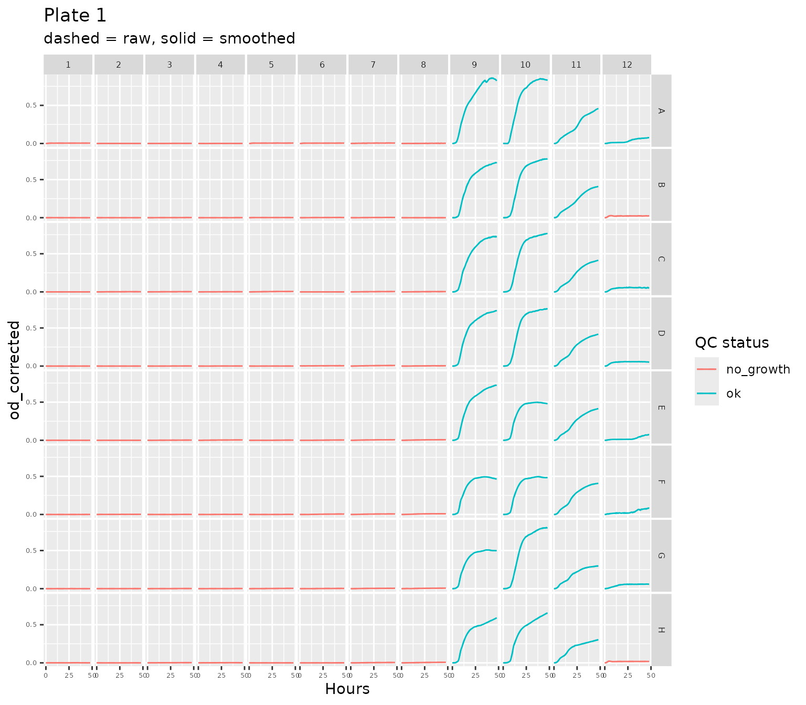
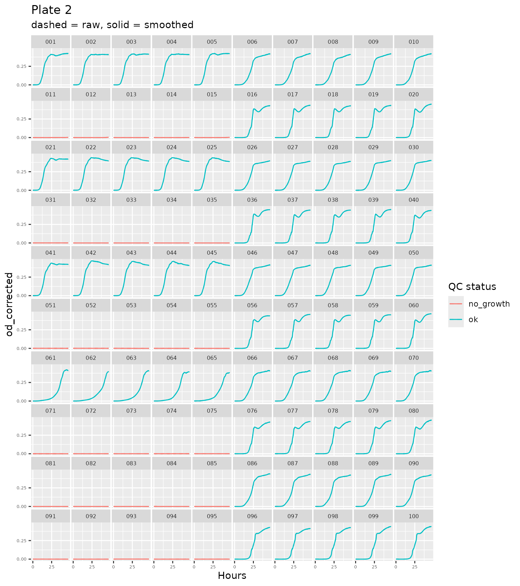

# Read, QC and plot plate reader data

plateReadeR reads output files from plate readers into a tidy table and
offers a few basic quality control (QC) steps. This vignette walks
through the whole workflow on a LogPhase600 plate: read, flag,
blank-correct, smooth and plot. Joining the data to sample metadata is
left to you.

``` r

library(plateReadeR)
```

## Read

Each reader returns one row per well per time point. Time is in elapsed
seconds/hours. These are snapped to a regular grid with
[`snap_hours()`](https://slhogle.github.io/plateReadeR/reference/snap_hours.md),
so that plates from different runs are harmonized and can later be
joined or aligned. This is necessary because there is sometimes some
drift that prevents joining by elapsed time.

| Function | Instrument | Format |
|----|----|----|
| [`read_logphase_txt()`](https://slhogle.github.io/plateReadeR/reference/read_logphase_txt.md) | LogPhase600 | text, one file per plate |
| [`read_logphase_xlsx()`](https://slhogle.github.io/plateReadeR/reference/read_logphase_xlsx.md) | LogPhase600 | Excel; `sheet = "raw"`, `"results"` or `"procedure"`, all plates combined. Returns one tibble for all plates |
| [`read_synergy_xlsx()`](https://slhogle.github.io/plateReadeR/reference/read_synergy_xlsx.md) | Synergy H1 | Excel time course; `sheet = "raw"`, `"results"` or `"setup"` |
| [`read_synergy_endpoint()`](https://slhogle.github.io/plateReadeR/reference/read_synergy_endpoint.md) | Synergy H1 | Excel single time point |
| [`read_bioscreen()`](https://slhogle.github.io/plateReadeR/reference/read_bioscreen.md) | Bioscreen C | UTF-16 text or csv, one or two 100-well plates |

``` r

f <- system.file("extdata", "logphase600_plate1.txt", package = "plateReadeR")
d <- read_logphase_txt(f)
d
#> # A tibble: 13,920 × 5
#>    seconds hours well     od plate_id
#>      <dbl> <dbl> <chr> <dbl> <chr>   
#>  1       0 0     A01   0.116 Plate 1 
#>  2    1200 0.333 A01   0.116 Plate 1 
#>  3    2400 0.667 A01   0.116 Plate 1 
#>  4    3600 1     A01   0.117 Plate 1 
#>  5    4800 1.33  A01   0.117 Plate 1 
#>  6    6000 1.67  A01   0.118 Plate 1 
#>  7    7200 2     A01   0.119 Plate 1 
#>  8    8400 2.33  A01   0.119 Plate 1 
#>  9    9600 2.67  A01   0.119 Plate 1 
#> 10   10800 3     A01   0.119 Plate 1 
#> # ℹ 13,910 more rows
```

Excel exports hold several different sheets for each plate. The most
useful one is the “Raw Data” sheet but sometimes the “Summary” sheet is
useful to determine how the Logphase600 calculated different growth
parameters (e.g., lagtime and growth rate). The “Procedure” sheet
describes the different technical specifications of the run. The
funcitons
[`read_logphase_xlsx()`](https://slhogle.github.io/plateReadeR/reference/read_logphase_xlsx.md)
and
[`read_synergy_xlsx()`](https://slhogle.github.io/plateReadeR/reference/read_synergy_xlsx.md)
can read each of these sheet types using the paramter `sheet`. The
procedure sheet is parsed into one row per plate:

``` r

xf <- system.file(
  "extdata",
  "logphase600_example.xlsx",
  package = "plateReadeR"
)
read_logphase_xlsx(xf, sheet = "procedure")[c(
  "plate_id",
  "runtime_hours",
  "interval_hours",
  "shaking_rpm",
  "wavelength_nm",
  "temperature_setpoint_c"
)]
#> # A tibble: 2 × 6
#>   plate_id runtime_hours interval_hours shaking_rpm wavelength_nm
#>   <chr>            <dbl>          <dbl>       <dbl>         <dbl>
#> 1 Plate 1             48          0.333         600           600
#> 2 Plate 2             48          0.333         600           600
#> # ℹ 1 more variable: temperature_setpoint_c <dbl>
```

Wells are only identified using `plate_id` and `well`, in every reader.
You will need to join these to your own metadata file to make them
unique across runs.

## Flag saturated and negative OD

[`flag_od_range()`](https://slhogle.github.io/plateReadeR/reference/flag_od_range.md)
adds well-level flags for wells that have either negative OD values or
values that exceed a threshold value. This `saturation` value needs to
be selected by the user. There is no default.

``` r

d <- flag_od_range(d, saturation = 2)
table(unique(d[c("well", "flag_saturated", "flag_negative")])[-1])
#>               flag_negative
#> flag_saturated FALSE
#>          FALSE    96
```

## Blank-correct

If you plate has blank wells (it should!)
[`blank_correct()`](https://slhogle.github.io/plateReadeR/reference/blank_correct.md)
can subtract blank wells from all other wells, with an OD floor at 0.
With no `blank` supplied, it is assumed that the first 5 reads in a well
are not measuring growth so these are averaged as a “pseudo-blank” and
then subtracted.

``` r

d <- blank_correct(d)
d[d$well == "A09", c("hours", "od", "blank_od", "od_corrected")][1:5, ]
#> # A tibble: 5 × 4
#>   hours    od blank_od od_corrected
#>   <dbl> <dbl>    <dbl>        <dbl>
#> 1 0     0.119    0.120     0       
#> 2 0.333 0.12     0.120     0       
#> 3 0.667 0.12     0.120     0       
#> 4 1     0.121    0.120     0.000600
#> 5 1.33  0.122    0.120     0.00160
```

Alternatively, you can name the blank wells. They are matched by time
within the same plate. If multiple blanks are supplied they are
averaged. (Not run here, because which wells are blanks depends on your
plate layout.)

``` r

blanks <- data.frame(plate_id = "Plate 1", well = c("A01", "B01"))
blank_correct(d, blank = blanks)
```

## Flag wells with no growth

[`flag_no_growth()`](https://slhogle.github.io/plateReadeR/reference/flag_no_growth.md)
flags wells whose corrected OD never increases past the `min_rise` OD
threshold. The default of 0.05 is a starting point: check it against
wells you know do and do not grow.

``` r

d <- flag_no_growth(d, min_rise = 0.05)
table(unique(d[c("well", "flag_no_growth")])$flag_no_growth)
#> 
#> FALSE  TRUE 
#>    30    66
```

## Smooth

Smoothing is off by default.
[`smooth_od()`](https://slhogle.github.io/plateReadeR/reference/smooth_od.md)
applies a 5-point centered rolling mean to each well. It adds
`od_corrected_rollmean`, leaving the raw and corrected columns intact.
(`blank_correct(smooth = TRUE)` does the same in one step.)

``` r

d <- smooth_od(d)
names(d)
#>  [1] "seconds"               "hours"                 "well"                 
#>  [4] "od"                    "plate_id"              "flag_saturated"       
#>  [7] "flag_negative"         "blank_od"              "od_corrected"         
#> [10] "flag_no_growth"        "od_corrected_rollmean"
```

## Plot

[`plot_plate()`](https://slhogle.github.io/plateReadeR/reference/plot_plate.md)
draws one panel per well for one plate. Curve color shows QC status. A
well with no flags is `"ok"`, and a well with several flags shows them
joined with `+`. With `smooth = TRUE` the smoothed curve is overlaid on
the raw one.

``` r

plot_plate(d, plate = "Plate 1", smooth = TRUE)
```



## A Bioscreen run

[`read_bioscreen()`](https://slhogle.github.io/plateReadeR/reference/read_bioscreen.md)
handles the Bioscreen C text export, which is UTF-16 with comma
decimals; both are detected and converted automatically. A Bioscreen C
run holds one or two 100-well plates, with wells 1 to 100 on plate 1 and
101 to 200 on plate 2. Wells are named by a zero-padded `well` within
each `plate_id` (`"001"` to `"100"`), so the key is the same `plate_id`
and `well` pair as for the LogPhase600. The position in the run (1 to
200) is kept as `well_index`. The `Blank` column the instrument writes
is always zero (don’t understand what this is for). This is dropped by
default.

The file below is a complete two-plate run, 567 reads at about 5-minute
intervals over 47 hours, stored xz-compressed (readers can read
compressed files directly).

``` r

bf <- system.file("extdata", "bioscreen_full.txt.xz", package = "plateReadeR")
b <- read_bioscreen(bf)
b
#> # A tibble: 113,400 × 6
#>    seconds  hours plate_id well  well_index    od
#>      <dbl>  <dbl> <chr>    <chr>      <int> <dbl>
#>  1       0 0      Plate 1  001            1 0.072
#>  2     300 0.0833 Plate 1  001            1 0.072
#>  3     600 0.167  Plate 1  001            1 0.072
#>  4     900 0.25   Plate 1  001            1 0.072
#>  5    1200 0.333  Plate 1  001            1 0.072
#>  6    1500 0.417  Plate 1  001            1 0.072
#>  7    1800 0.5    Plate 1  001            1 0.072
#>  8    2100 0.583  Plate 1  001            1 0.072
#>  9    2400 0.667  Plate 1  001            1 0.072
#> 10    2700 0.75   Plate 1  001            1 0.073
#> # ℹ 113,390 more rows
```

The same QC steps from the logphase600 apply to the bioscreen. Here the
smoothed curve is added during blank correction with `smooth = TRUE`.

``` r

b <- b |>
  flag_od_range(saturation = 2) |>
  blank_correct(smooth = TRUE) |>
  flag_no_growth()

unique(b[c(
  "plate_id",
  "well",
  "flag_saturated",
  "flag_negative",
  "flag_no_growth"
)]) |>
  subset(select = -well) |>
  aggregate(
    cbind(flag_saturated, flag_negative, flag_no_growth) ~ plate_id,
    data = _,
    FUN = sum
  )
#>   plate_id flag_saturated flag_negative flag_no_growth
#> 1  Plate 1              0             0              0
#> 2  Plate 2              0             0             30
```

Wells on a Bioscreen plate are laid out as a square grid of numbers
rather than lettered rows, so
[`plot_plate()`](https://slhogle.github.io/plateReadeR/reference/plot_plate.md)
draws them as a 10 by 10 grid.

``` r

plot_plate(b, plate = "Plate 2", smooth = TRUE)
```


